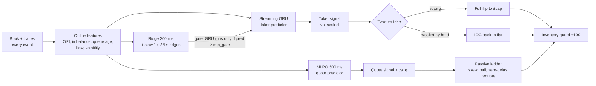

# AlgoTrade — team `p<0.05` at Algo Trade Arena 2026

A high-frequency market-making and short-horizon taker strategy for a single-instrument limit
order book, together with the research toolkit we built to develop it during **Algo Trade Arena 2026**
(Qminers × MFF UK). The event was a 24-hour hackathon: four 5-hour rounds, a new recorded market tape
for each round, and server-side scoring.

**Final strategy:** [`submission/best_strategy.py`](submission/best_strategy.py) (= `strategies/mm_r4_mixv3.py`).
**Server PnL, round 4:** 1,810,997 for mixv3. The best confirmed board score was 1,815,208 (mixv4).

---

## Results

| Round | What we ran | Server PnL | Notes |
|---|---|---:|---|
| Practice | `mm_v2`: symmetric quoting at the touch | +240,995 | 3rd place |
| Round 1 | `mm_r1_final*`: quoting + ridge-signal stubs | 511,422 | 12th; leader 792,696 |
| Round 2 | `mm_r2_zd`: drift gate + zero-delay take | 849,747 | public board |
| Round 3 | `mm_r3_gru*`: streaming GRU taker | 984,495 | private re-run 874,971 |
| Round 4 | `mm_r4_mixv3`: two-tier take + quote-MLP scale | **1,810,997** | +134,829 over the round-4 baseline |

Round-4 server progression, each step verified on the board:

```
s14 baseline     1,676,168
mix  x1.15       1,720,970   models refitted on round3 + round4 (first 75 %)
mixv             1,763,582   volatility-scaled taker signal and thresholds
mixv3            1,810,997   two-tier take + quote-MLP scale cs_q 1.6
mixv4            1,815,208   + gate_thr 48
mixv5            last upload, score not recorded   + ht_d 0.15, ht_tgt 30, mlp_gate 0.1
```

---

## The market and the scoring

- **One instrument**, integer price ticks, no fees, 5 ms order latency.
- The tape is **replayed and non-reactive**. Other participants never react to our orders, but our
  orders do match against the replayed book with price-time priority.
- A **flat 10,000 $/s penalty** applies whenever |inventory| > 100, which works as a hard ±100 cap.
- Score = PnL marked to market at the end of the tape.

The non-reactive replay is what creates the edge. A replayed IOC only removes liquidity up to its
own limit, which leaves "zombie" quotes behind. A passive order also fills only when a recorded
aggressor reaches it in the queue. Most of our gains came from modelling exactly *when* a fill
happens and *what the price does next*, not from classic spread capture.
[`docs/kontext.md`](docs/kontext.md) holds the full rules; the `arena-market-mechanics` skill in
[`.claude/skills/`](.claude/skills/) holds the matching engine notes.

---

## How the final strategy works

`mm_r4_mixv3` is one `BaseStrategy` subclass (~1,800 lines, numpy only, every model inlined as
weights). It ends up as a **cap-bound flipper**: |inventory| sits at the ±100 limit most of the time,
and about 87 % of PnL comes from taker flips.



| Component | What it does |
|---|---|
| **Fair value + ridge predictor** | 200 ms mid-move forecast from order-flow features, refitted on the current round's first 75 % |
| **Streaming GRU** | Sequence model over recent events. It replaces the MLP when the ridge says something is happening (`mlp_gate`) |
| **Two-tier take** (`ht_*`) | A strong signal flips the whole position. A weaker one (threshold − `ht_d`) only closes the exposure we hold against it |
| **Quote MLP** (`MLPQ[500]`, `cs_q`) | A 500 ms forecast that skews and pulls passive quotes away from the predicted move |
| **Zero-delay take / requote** | The cancel and the new order go out in the same callback, which saves ≥ 5 ms of queue position. A guard IOCs back under the cap if a race fill pushes us over |
| **Slow-direction gate** | 1 s / 5 s ridges stop quotes from leaning into a sustained drift |

Every mechanic sits behind a `PARAMS` flag. All flags off reproduces the earlier champion exactly,
and this parity is what lets each change be judged in isolation.

---

## Research methodology

Short-horizon PnL is noisy: the server standard error is about 54k on a 1.8M score. Our rules:

1. **Every change is a flag.** Copy the champion, add one mechanic, and prove flag-off parity
   (identical PnL) before any sweep.
2. **Three judges, not one number.** Each challenger runs on
   - **Slice A:** holdout = the last 25 % of the round tape, plus a *mirror* tape (price-reflected copy);
   - **Slice B:** walk-forward refit on the earlier part, scored on the later part;
   - the earlier rounds' tapes, as a regime-transfer check.
3. **Paired by time chunk.** [`research/compare.py`](research/compare.py) pairs champion and challenger
   chunk by chunk. A challenger is accepted only when it wins most chunks *and* the holdout.
4. **Everything goes in the ledger.** Every run lands in `research/results/*.csv`, failures included.
   The narrative is in [`docs/progress.md`](docs/progress.md).
5. **Sandbox check before upload.** [`research/check.py`](research/check.py) runs the arena's
   static rules and a timed smoke run.

### What worked

- **Policy changes beat model accuracy.** The two-tier take, the quote-MLP scale, and the
  volatility-scaled thresholds moved the server score. Seed ensembles and multi-level OFI raised
  offline correlation by about 0.01 and did nothing for PnL.
- **Execution timing.** Zero-delay take/requote and queue-aware crediting were worth more than any
  single feature.
- **Refitting per round** on round data plus mirror data, then validating on a holdout the fit never saw.
- **Local-to-server ratio** (~1.645 in round 4) used as a sanity check on every upload.

### What did not work

- A third take tier, volatility stops, time stops, exit-quote skew, quote ensembles. All were
  flat or holdout-negative, and every one is logged.
- Gains under ~1 % locally almost never transferred to the server. We stopped chasing them.
- Pure passive market making at the touch loses to adverse selection on these tapes. Quotes only
  pay when they lean on a forecast.

---

## Repository layout

```
submission/best_strategy.py   the uploaded strategy (final = mm_r4_mixv3)
strategies/                   every strategy version and experiment (mm_*, exp_*, rd_*), kept, never deleted
research/                     backtest runner, compare, sandbox check, features, signal and model training
  run.py · compare.py         parallel parameter sweeps; paired champion-vs-challenger verdict
  check.py                    pre-upload sandbox and runtime check
  round.py                    one-command round kickoff (baselines, data card, signals, taker scan)
  features*.py · signals.py   offline features, IC and walk-forward signal research
  train_mlp.py · retrain*.py  MLP / GRU training, numpy export into strategies
  diag/                       one-off diagnostics (fill decomposition, MLOFI, ensembles, mirrors)
  results/                    the experiment ledger (CSV per run)
simulator/ · explorer/        exchange simulator and backtest explorer (from the organisers' starter)
docs/                         rules, progress log, playbooks, handoffs between team members and agents
.claude/skills/               agent skills used in the workflow (market mechanics, experiments, pre-submit)
```

Some working docs (progress log, playbooks) are in Czech; code and docstrings are in English.

---

## Quick start

Requires [uv](https://docs.astral.sh/uv/) (it installs Python 3.13 and all dependencies).

```bash
uv sync
uv run python -m gzip -d data/sample.csv.gz
uv run exchange-simulator --strategy submission/best_strategy.py --backtest data/sample.csv --log-dir logs/demo
```

Sweep and compare:

```bash
uv run python -m research.run --strategy strategies/mm_r4_mixv3.py --data data/sample.csv --grid '{"cs_q": [1.3, 1.6]}' --tag demo
```

```bash
uv run python -m research.compare --a submission/best_strategy.py --b strategies/mm_r4_mixv5.py --data data/sample.csv
```

> **Data.** The competition tapes (rounds 1–4) belong to the organisers and are **not** included
> or redistributed here. Only the starter's synthetic `data/sample.csv.gz` ships with the repo. The
> strategies run on any tape in the same CSV format. The models were fitted on the round tapes, so
> PnL on the sample is not representative.

### Writing your own strategy

A strategy is one `.py` file with one `BaseStrategy` subclass:

```python
from simulator.models import OrderBookSnapshot, OrderRequest, OrderType, PrivateOrderEvent, Side, Trade
from simulator.strategy import BaseStrategy

class MyStrategy(BaseStrategy):
    def on_order_book_change(self, snapshot: OrderBookSnapshot, trades: list[Trade]) -> None: ...
    def on_private_order_update(self, event: PrivateOrderEvent) -> None: ...
```

`self.send_order(OrderRequest(side, price, qty, order_type))` with `OrderType.LIMIT` or
`OrderType.IOC`, `self.cancel_order(id)`, `self.modify_order(id, new_qty)` and `self.now_us()` are
the whole API. Start from `strategies/template_strategy.py`.

---

## Team

**`p<0.05`**: Honza ([@Herz1c](https://github.com/Herz1c)), strategy lead, and Tomáš
([@radys-s](https://github.com/radys-s)), research workflow and review. We ran a two-machine setup:
a laptop and a home GPU node, coordinated through git branches (`herzic`, `radys`, `home`).
AI coding agents did much of the implementation and the sweeps, under human direction; see
[`TEAM.txt`](TEAM.txt).

## Credits

- The exchange simulator, explorer and starter layout come from the organisers' public starter,
  [QminersOrg/qminers-algo-arena](https://github.com/QminersOrg/qminers-algo-arena).
- The skills in `.claude/skills/` include adapted third-party material; see
  [`.claude/skills/THIRD_PARTY.md`](.claude/skills/THIRD_PARTY.md).
- Thanks to Qminers and MFF UK for running Algo Trade Arena 2026.
